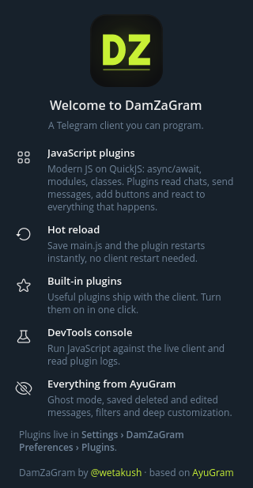
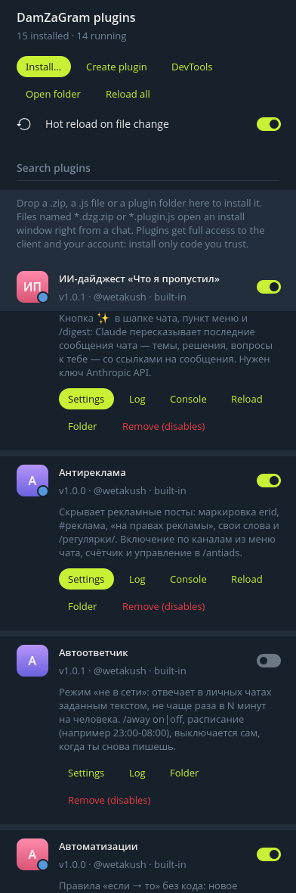
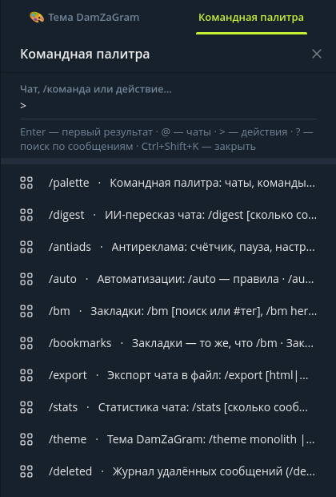
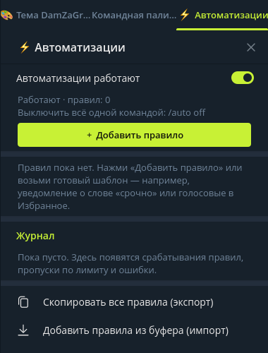
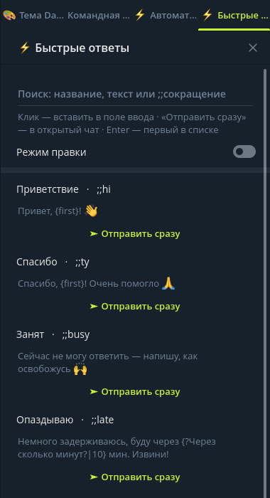
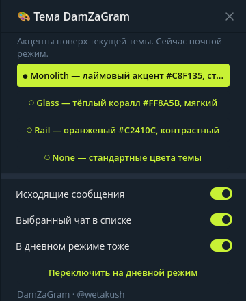
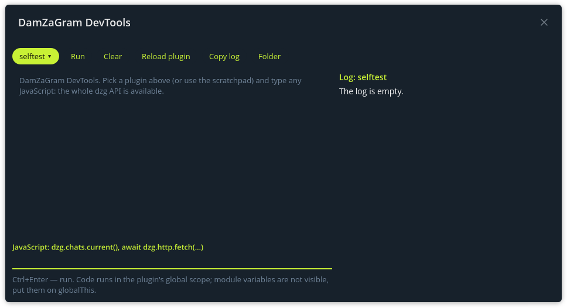

<div align="center">


# DamZaGram

**Telegram-клиент, который можно программировать.**

Всё, что есть в [AyuGram](https://github.com/AyuGram/AyuGramDesktop), — режим призрака, сохранение удалённого, глубокая кастомизация —
плюс полноценная **система плагинов на JavaScript** с горячей перезагрузкой, встроенными плагинами и консолью DevTools.

автор — [**@wetakush**](https://t.me/wetakush)

[ [English](README.md) | Русский ]

</div>

## Скриншоты

<table>
<tr>
<td align="center"><br><sub>Приветствие</sub></td>
<td align="center"><br><sub>Менеджер плагинов</sub></td>
<td align="center"><br><sub>Командная палитра</sub></td>
</tr>
<tr>
<td align="center"><br><sub>Автоматизации</sub></td>
<td align="center"><br><sub>Быстрые ответы</sub></td>
<td align="center"><br><sub>Тема DamZaGram</sub></td>
</tr>
</table>

<p align="center"><br><sub>Консоль DevTools</sub></p>

Сняты в живой сборке: панели плагинов встают справа от чата.

## Возможности

### Всё из AyuGram

- Полный режим призрака (настраиваемый): без прочтений, онлайна, «печатает…», тайный просмотр историй
- История сообщений: удалённые и изменённые сообщения сохраняются и помечаются
- Анти-удаление
- Фильтры сообщений (регулярки, по чатам, общие списки фильтров)
- Кастомизация шрифтов, иконки приложения, режим стримера
- Локальный Telegram Premium
- Переводчик
- Улучшенный внешний вид и масса мелочей

Документация AyuGram по-прежнему подходит для всего этого: [docs.ayugram.one](https://docs.ayugram.one/desktop/).

### Плагины на JavaScript

- **Современный JavaScript.** Плагины работают на [QuickJS-ng](https://github.com/quickjs-ng/quickjs) (ES2023):
  `async`/`await`, ES-модули, классы, `import`/`export`, `await` верхнего уровня в консоли.
- **Доступ ко всему.** Чаты, сообщения (отправка, правка, удаление, пересылка, реакции, поиск, загрузка),
  пользователи и аккаунты, события (`message.new`, `message.edited`, `message.deleted`, `chat.opened`, …),
  фильтры сообщений, хуки перед отправкой и `/команды`, пункты контекстных меню, кнопки в интерфейсе, окна,
  тосты, нативные виджеты, цвета темы, HTTP, файлы, буфер обмена.
- **Горячая перезагрузка.** Сохрани `main.js` — плагин перезапустится сразу, без перезапуска клиента.
- **Консоль DevTools.** Выполняй JavaScript прямо в живом клиенте и смотри логи плагинов
  (Настройки → Настройки DamZaGram → Плагины → DevTools, `Ctrl+Enter` — выполнить).
- **Настройки без кода.** Опиши настройки в `manifest.json` — DamZaGram сам нарисует интерфейс.
- **Типизированный API.** Определения TypeScript в [`docs/plugins/types`](docs/plugins/types) дают автодополнение в любом редакторе.

Полная документация: [`docs/plugins`](docs/plugins).

### Встроенные плагины

С клиентом идут четырнадцать плагинов. Все, кроме автоответчика, работают с первого запуска; включить, выключить и
настроить любой можно в Настройки → Настройки DamZaGram → Плагины (или `Ctrl+Shift+P`, когда фокус не в поле ввода).

| Плагин | Что делает |
|---|---|
| Командная палитра | `Ctrl+Shift+K`: нечёткий поиск по чатам, командам плагинов и действиям клиента |
| ИИ-дайджест | «Что я пропустил»: Claude пересказывает последние сообщения чата (`/digest`, нужен ключ API Anthropic) |
| Удалённые сообщения | Сообщает, кто, где и что удалил; журнал удалённого |
| Напоминания | `/remind 10m купить хлеб`, `/remind 18:30 созвон`, «Напомнить через…» в меню сообщения |
| Статистика чата | Кто пишет больше всех, активные часы и дни, любимые слова и эмодзи |
| Ключевые слова | Уведомляет, когда в любом чате появляется слово или `/регулярка/` |
| Автоответчик | Режим «не в сети» для личных чатов (по умолчанию выключен) |
| Текстовые инструменты | `/calc`, исправление раскладки «ghbdtn» → «привет», `/upper` `/mock` `/b64`…, автозамена `:shrug:` |
| Антиреклама | Скрывает рекламные посты (`erid:`, «Реклама», `#ad`…) в каналах, `/antiads` |
| Тема DamZaGram | Пресеты акцентов Monolith / Glass / Rail поверх любой темы, `/theme` |
| Автоматизации | Правила «если → то» без кода: новое сообщение, расписание или открытие чата → уведомление, ответ, реакция, пересылка, Избранное, прочитать, без звука, webhook; лимиты и защита от петель, `/auto` |
| Быстрые ответы | Заготовки текста с переменными (`{first}`, `{date}`, `{?вопрос}`): кнопка у поля ввода, `/q название`, `;;сокращение` |
| Закладки | Любое сообщение — в закладки с заметкой и тегами; панель с поиском `/bm`, кнопка в шапке чата, экспорт в Markdown |
| Экспорт чата | История чата в самодостаточную HTML-страницу, Markdown или JSON, с прогрессом и периодом по датам, `/export` |

Исходники каждого лежат в [`plugins/builtin`](plugins/builtin) — лучший способ изучить API на живых примерах.
Подробно о каждом плагине: [`docs/plugins/builtins.md`](docs/plugins/builtins.md).

### Что нового

- Четыре новых встроенных плагина: «Автоматизации», «Быстрые ответы», «Закладки» и «Экспорт чата».
- События плагинов вроде `message.new` приходят на следующей итерации цикла событий, а не внутри уведомлений самого
  клиента, и только тем плагинам, которые на них подписаны. У сообщений есть `selfId` — аккаунт, которому оно пришло.
- Цвета темы у каждого плагина свои: `dzg.theme.reset()` убирает только твои цвета, после смены темы или ночного
  режима цвета плагинов возвращаются сами, а `dzg.theme.get()` читает цвет.
- Установка и удаление плагина больше не перезапускают остальные, а запись плагина в свою папку через `dzg.fs.write`
  больше не вызывает горячую перезагрузку.
- `Ctrl+Shift+P` открывает менеджер плагинов только вне полей ввода, поэтому в поле сообщения оно по-прежнему
  делает спойлер.
- Автообновление выключено: своего сервера обновлений у DamZaGram пока нет.

### Первый плагин за 30 секунд

Открой **Настройки → Настройки DamZaGram → Плагины → Открыть папку плагинов** (`<папка данных>/tdata/plugins/`)
и создай в ней папку `hello` с двумя файлами:

`manifest.json`
```json
{
  "id": "hello",
  "name": "Привет",
  "version": "1.0.0",
  "author": "я",
  "settings": [
    { "key": "word", "type": "string", "title": "Слово", "default": "привет" }
  ]
}
```

`main.js`
```js
dzg.on('message.new', (m) => {
  if (!m.out && m.text.includes(dzg.settings.get('word'))) {
    dzg.ui.toast(`${m.fromName} в «${m.chat.name}»: ${m.text}`);
  }
});
```

Включи его в **Плагинах**. Поправь `main.js`, сохрани — он перезагрузится сам.

> Плагины получают **полный доступ** к клиенту, аккаунту, файлам и сети. Ставь только тот код, которому доверяешь.

## Папка данных

DamZaGram хранит данные отдельно от Telegram Desktop и AyuGram, так что все три можно держать установленными одновременно:

| ОС | Папка |
|---|---|
| Linux | `~/.local/share/DamZaGramDesktop` |
| Windows | `%APPDATA%\DamZaGram Desktop` |
| macOS | `~/Library/Application Support/DamZaGram Desktop` |

С ключом `-workdir <путь>` клиент запустится с любой другой папкой. Linux application id: `com.damzagram.desktop`.

## Сборка на Arch Linux

### 1. Зависимости

```bash
sudo pacman -S --needed base-devel git cmake ninja python mold ccache \
  qt6-base qt6-svg qt6-wayland qt6-imageformats qt6-declarative qt6-shadertools qt6-5compat qt6-tools \
  abseil-cpp ada boost fmt range-v3 tl-expected microsoft-gsl extra-cmake-modules wayland-protocols \
  ffmpeg openal openh264 openssl protobuf lz4 xxhash minizip hunspell rnnoise pipewire \
  glibmm-2.68 libsigc++-3.0 gobject-introspection kcoreaddons jemalloc \
  libjxl libavif libheif libvpx libxcomposite libxdamage libxrandr libxtst libxkbcommon libdrm \
  webkit2gtk-4.1 python-packaging
# этих нет в официальных репозиториях — берём из AUR:
yay -S --needed libtg_owt tlottie qrcodegencpp-cmake
```

### 2. tde2e (библиотека сквозного шифрования из TDLib)

```bash
git clone https://github.com/tdlib/td.git ../DamZaGram-deps/tde2e
cmake -S ../DamZaGram-deps/tde2e -B ../DamZaGram-deps/tde2e/build -G Ninja \
  -DCMAKE_BUILD_TYPE=Release -DTD_E2E_ONLY=ON \
  -DCMAKE_INSTALL_PREFIX="$PWD/../DamZaGram-deps/tde2e/install"
cmake --build ../DamZaGram-deps/tde2e/build --target install
```

### 3. Конфигурация и сборка

Свои `api_id` / `api_hash` возьми на [my.telegram.org](https://my.telegram.org) (см. [docs/api_credentials.md](docs/api_credentials.md)).

```bash
git clone --recursive <этот репозиторий> DamZaGram && cd DamZaGram
cmake -S . -B out -G Ninja \
  -DCMAKE_BUILD_TYPE=Debug \
  -DTDESKTOP_API_ID=ТВОЙ_API_ID \
  -DTDESKTOP_API_HASH=ТВОЙ_API_HASH \
  -Dtde2e_DIR="$PWD/../DamZaGram-deps/tde2e/install/lib/cmake/tde2e" \
  -DCMAKE_C_COMPILER_LAUNCHER=ccache \
  -DCMAKE_CXX_COMPILER_LAUNCHER=ccache \
  -DCMAKE_EXE_LINKER_FLAGS=-fuse-ld=mold
cmake --build out --target Telegram
./out/bin/DamZaGram
```

`-DCMAKE_BUILD_TYPE=Release` даст быстрый бинарник, но собирается заметно дольше.

### 4. Добавить в меню приложений (по желанию)

```bash
tools/damza/install-desktop-entry.sh            # регистрирует out/bin/DamZaGram для текущего пользователя
tools/damza/install-desktop-entry.sh --uninstall
```

Или поставь в систему: `sudo cmake --install out`.

### Инструменты разработчика

- `tools/damza/check.py <файл.cpp>` — проверка синтаксиса одного файла с настоящими флагами сборки, за секунды.
- `tools/damza/sandbox.py <плагин/main.js> [test.js]` — запуск плагина на настоящем JS API в чистом QuickJS с подменённым клиентом.
- `tools/damza/tests/builtins/run.py [id…]` — тесты встроенных плагинов в той же песочнице.

## Благодарности

DamZaGram делает [@wetakush](https://t.me/wetakush). Он стоит на плечах:

- [**AyuGram Desktop**](https://github.com/AyuGram/AyuGramDesktop) от Radolyn Labs — основа DamZaGram и все функции призрака
  и кастомизации. Поддержите оригинальных авторов: [docs.ayugram.one/donate](https://docs.ayugram.one/donate/).
- [**Telegram Desktop**](https://github.com/telegramdesktop/tdesktop) от Telegram FZ-LLC.
- [**QuickJS-ng**](https://github.com/quickjs-ng/quickjs) — JavaScript-движок плагинов (MIT).
- Клиенты, которых благодарит AyuGram: [Kotatogram](https://github.com/kotatogram/kotatogram-desktop),
  [64Gram](https://github.com/TDesktop-x64/tdesktop), [Forkgram](https://github.com/forkgram/tdesktop).
- Библиотеки: [JSON for Modern C++](https://github.com/nlohmann/json), [SQLite](https://github.com/sqlite/sqlite),
  [sqlite_orm](https://github.com/fnc12/sqlite_orm), [исходники androidx](https://github.com/androidx/androidx).
- Иконки: [Solar Icon Set](https://www.figma.com/community/file/1166831539721848736).

## Лицензия

DamZaGram, как Telegram Desktop и AyuGram, — свободная программа под
[GNU GPL версии 3](LICENSE) с исключением для OpenSSL. См. [LEGAL](LEGAL).
DamZaGram — неофициальный клиент, не связанный с Telegram или Radolyn Labs.
